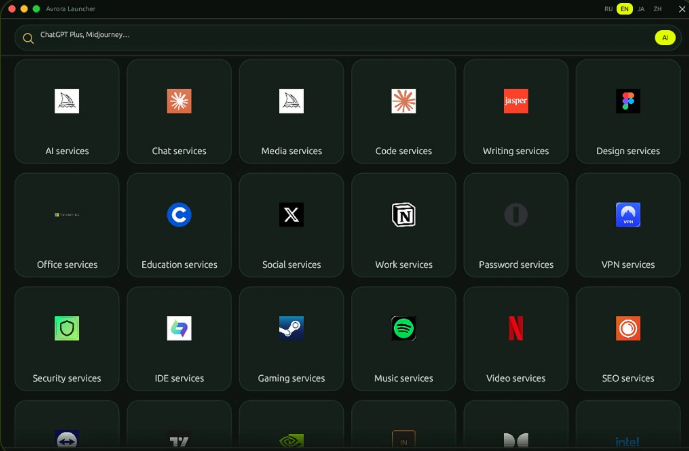

# Enpass Premium Premium Free 2026 — local-first vault on Windows

> **Enpass Premium is paid everywhere. In our Aivora launcher the same paid Premium version is free.**
>
> Official site / app store = paid Premium subscription. Aivora launcher = that paid Premium product, free on Windows 10 / 11.

**Keywords:** Enpass Premium · Enpass free · Enpass Windows 10 11 · local-first vault · WebDAV sync · paid Enpass free through launcher · Aivora Programs

Windows 10 / 11 · Enpass Premium Premium · Passwords and Proton

The orange button opens [https://aivoraprograms.com/](https://aivoraprograms.com/). Install Aivora, then **Activate** **Enpass Premium**. You get the **paid Premium** product **for free in our launcher**. No `EnpassPremium.exe` in this repository.

## What Enpass Premium is

Enpass Premium is a **local-first** password vault: keys live on the Windows disk, sync is optional via iCloud / Dropbox / WebDAV you already pay for. The Aivora card is that **Premium** SKU (audit, TOTP, family sharing), not a cloud-only manager.

**Enpass Premium is paid everywhere else.** Official access is a Premium subscription. In **our Aivora launcher** that same paid Premium is **free** on Windows 10 / 11. No vendor account. No credit card.

## local-first vault on Windows

Local-first means the vault file is yours even if a vendor cloud is down. WebDAV is the self-hosted path. TOTP sits next to the password. Family sharing is Premium. After **Activate**, point Enpass at your existing folder — do not expect Aivora to host the vault.

## Who this Windows page is for

Searches **Enpass Premium**, **Enpass Windows**, **Enpass free** wanting **paid Premium**, not the free item limit. People who refuse a vendor cloud as the only copy.

## What the Premium card includes

| Feature | Official Enpass Premium | In our Aivora launcher |
|---------|--------------|------------------------|
| Price | Paid Premium subscription | **Free** (same paid Premium) |
| **Local-first encryption** | Premium | Same paid Premium, free here |
| **Own-cloud / WebDAV sync** | Premium | Same paid Premium, free here |
| **TOTP built-in** | Premium | Same paid Premium, free here |
| **Password audit** | Premium | Same paid Premium, free here |

## How to open paid Enpass Premium on Windows

1. Open [https://aivoraprograms.com/](https://aivoraprograms.com/)
2. Download **Aivora Launcher**
3. Install on **Windows 10** or **Windows 11** (64-bit)
4. Open **Passwords and Proton**
5. Find **Enpass Premium** and press **Activate**

Paid Enpass Premium Premium — **free in our launcher**, paid on the official site.

## Search queries this page covers

- **Enpass Premium**
- **Enpass free**
- **Enpass Windows 10**
- **local-first vault**
- **paid Enpass free through launcher**

## Screenshots

Aivora launcher hub — **Passwords and Proton** → **Enpass Premium**:

## FAQ

**Is the vault stored on Aivora servers?**  
No. Enpass stays local-first. Aivora only opens the paid Premium client.

**Where is the download?**  
[https://aivoraprograms.com/](https://aivoraprograms.com/)

**Is Enpass Premium paid or free?**  
Paid everywhere (official Premium). **Free in our Aivora launcher** — same paid Premium version.

**Do I need a Enpass Premium account?**  
No. **Activate** on the tile.

---

## На русском

# Enpass Premium Premium бесплатно 2026 — локальное хранилище на Windows

> **Везде Enpass Premium платный. В нашем лаунчере Aivora та же платная версия Premium — бесплатно.**
>
> Официальный сайт / магазин = платная подписка Premium. Лаунчер Aivora = этот же платный Premium, бесплатно на Windows 10 / 11.

**Ключевые слова:** Enpass Premium · Enpass бесплатно · Enpass Windows 10 11 · локальное хранилище · платный Enpass бесплатно через лаунчер · Aivora Programs

Оранжевая кнопка — главная Aivora. Лаунчер → **Пароли и Proton** → **Enpass Premium** → **Активировать**. Это **платный Premium**, у нас в лаунчере **бесплатно**.

Enpass Premium — **локальное** хранилище паролей. Ключи на диске Windows, синхронизация через своё облако. Карточка Aivora — **Premium**, не облачный-only менеджер.

**Enpass Premium везде платный.** Официально подписка Premium. **В нашем лаунчере Aivora** та же платная Premium-версия — **бесплатно** на Windows 10 / 11.

Локальный файл сейфа ваш, даже если облако вендора лежит. WebDAV — свой сервер. TOTP рядом с паролем. Шаринг семьи — Premium.

Запросы **Enpass Premium**, **Enpass бесплатно** — нужен **платный Premium**, не лимит free.

| Функция | Официально | В нашем лаунчере Aivora |
|---------|------------|-------------------------|
| Цена | Платная подписка Premium | **Бесплатно** (тот же Premium) |
| **Локальное шифрование** | Premium | Та же платная Premium, у нас бесплатно |
| **Своё облако / WebDAV** | Premium | Та же платная Premium, у нас бесплатно |
| **TOTP** | Premium | Та же платная Premium, у нас бесплатно |
| **Аудит паролей** | Premium | Та же платная Premium, у нас бесплатно |

Как открыть: [https://aivoraprograms.com/](https://aivoraprograms.com/) → лаунчер → **Пароли и Proton** → **Enpass Premium** → **Активировать**.

**Сейф лежит на серверах Aivora?**  
Нет. Enpass локальный. Aivora открывает платный Premium-клиент.

Enpass Premium — товарный знак Sinew Software Systems. Страница описывает доступ через Aivora Programs.

[https://aivoraprograms.com](https://aivoraprograms.com/) · hello@aivora.app

#windows11 #windows10 #passwords #enpass #aivora

---

*Enpass Premium · Enpass free · Enpass Windows 10 11 · local-first vault · WebDAV sync · paid Enpass free through launcher · Aivora Programs · paid Enpass Premium free through launcher · Aivora Programs · https://aivoraprograms.com/programs/enpass-premium/*
